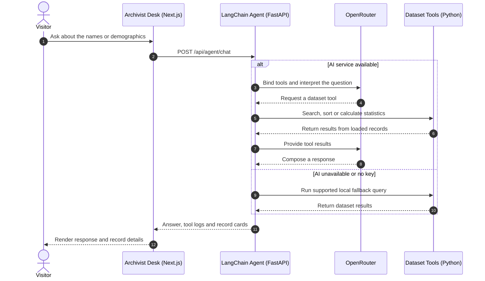

<div align="center">

# 🕊️ Palestine Names — أسماء لا تُنسى

### *From Numbers to Names · An Interactive Memorial & Searchable Archive*

[](https://nextjs.org/)
[](https://react.dev/)
[](https://www.typescriptlang.org/)
[](https://fastapi.tiangolo.com/)
[](https://www.python.org/)
[](https://www.langchain.com/)
[](https://threejs.org/)
[](https://openrouter.ai/)

<br />

> **A number is counted, but a name is remembered.**

[](https://palestine.babaqi.io)

**[🌐 Live Website](https://palestine.babaqi.io)** · **[📖 Search the Archive](https://palestine.babaqi.io/archive)**

<br />

[🌟 Overview](#overview) •
[📖 Narrative Flow](#narrative-flow) •
[🌿 Data Source](#data-source) •
[🤖 AI Archivist](#ai-archivist) •
[⚙️ Environment Setup](#environment-setup) •
[🚀 Quick Start](#quick-start) •
[🔎 Archive Search](#archive-search) •
[🎨 Design System](#design-system)

---

</div>

<br />

<a id="overview"></a>

## 🌟 Overview

**Palestine Names — أسماء لا تُنسى (Names That Are Not Forgotten)** is an Arabic digital memorial and searchable archive honoring Palestinians killed in Gaza. It brings names, ages and documented records into focus, creating a place to read, remember and reflect on the people behind the numbers.

The experience combines a **six-chapter, scroll-driven narrative**, **WebGL human silhouettes**, **Arabic editorial typography (Amiri & IBM Plex Sans Arabic)** and a **searchable names archive**. An optional **LangChain AI Archivist** helps visitors explore the loaded records through conversation.

**[Visit palestine.babaqi.io](https://palestine.babaqi.io)** to experience the memorial, or **[open the archive](https://palestine.babaqi.io/archive)** to search directly.

### ✨ What You Can Explore

- 🕊️ **An immersive memorial:** Human silhouettes gather into a number, the map of Palestine, an olive tree and the word Palestine, connecting the visual journey to the names it remembers.
- 📖 **A searchable archive:** Search Arabic or English names, filter by exact age, change the result order, browse pages and open individual records. Search state is preserved in the URL.
- 🌳 **Generations in the records:** Explore age groups and demographic statistics calculated from the loaded names list.
- 🤖 **An optional AI Archivist:** Ask questions using dataset search and statistics tools, with a local fallback when the AI service is unavailable.
- ♿ **Accessible reading:** Keyboard navigation, native record dialogs, reduced-motion support, responsive layouts and a readable archive when WebGL is unavailable.

<a id="narrative-flow"></a>

## 📖 The Narrative Flow

```text
                  THE SCROLL-DRIVEN JOURNEY

  [ 00 · FROM NUMBERS TO NAMES ]  A count drawn from the loaded names list
         │
         ▼
  [ 01 · A LIVING MAP ]           Human silhouettes form the map of Palestine
         │
         ▼
  [ 02 · ONE NAME, A WHOLE LIFE ] A moment to read an individual record
         │
         ▼
  [ 03 · GENERATIONS & MEMORY ]   Age groups and an olive-tree formation
         │
         ▼
  [ 04 · THE ARCHIVIST'S DESK ]   A reading folio and optional AI conversation
         │
         ▼
  [ 05 · WHAT REMAINS ]           Poetry, Palestine calligraphy and source credits
```

The dedicated **[/archive](https://palestine.babaqi.io/archive)** page provides access to the complete loaded list independently of the visual journey.

<a id="data-source"></a>

## 🌿 Data Source — Tech For Palestine

<div align="center">

<a href="https://data.techforpalestine.org/docs/killed-in-gaza/">
  
</a>

**Names dataset provided by [Tech For Palestine](https://techforpalestine.org/)**

[📚 Dataset Documentation](https://data.techforpalestine.org/docs/killed-in-gaza/) •
[💻 Dataset Repository](https://github.com/TechForPalestine/palestine-datasets) •
[📄 Source CSV](https://data.techforpalestine.org/api/v3/killed-in-gaza.csv)

</div>

This archive uses **Tech For Palestine's publication of Ministry of Health lists from Gaza**. We thank the maintainers and contributors who make these records accessible and support the work of preserving names.

> [!IMPORTANT]
> Counts and demographic statistics describe **the people listed in the loaded dataset**, not every reported casualty. The visual formations use a performance-limited sample; the searchable archive represents the complete loaded list. The map is a memorial formation, not a record of individual locations.

The official, unmodified logo is included from Tech For Palestine's [media kit](https://techforpalestine.org/media); [asset attribution](frontend/public/logos/README.md) is recorded in the repository. Source credit does not imply a partnership or endorsement.

<a id="environment-setup"></a>

---

## 🔑 Environment Variables & API Configuration

The memorial, archive, search and statistics work **without an AI key**. The optional AI Archivist uses **LangChain** with **OpenRouter** for model inference and dataset tool calls.

### 1. Get an API Key

To enable AI responses, obtain a free or paid key from [OpenRouter](https://openrouter.ai/keys).

### 2. Configure the Backend `.env`

From the `backend/` directory:

```bash
cp .env.example .env
```

Set your key in `backend/.env`:

```env
OPENROUTER_API_KEY=your_openrouter_api_key_here
```

### 3. Environment Variables Reference

| Variable | Used By | Default / Fallback | Description |
| --- | --- | --- | --- |
| `OPENROUTER_API_KEY` | Backend | Empty | Optional OpenRouter authentication; a local algorithmic fallback remains available. |
| `DATA_SYNC_ENABLED` | Backend | `true` | Enables startup and 24-hour background data checks. |
| `DATA_CACHE_PATH` | Backend | `backend/.cache/names.json` | Writable persistent snapshot path. |
| `API_URL` | Next.js server/build | `http://127.0.0.1:8000` | Backend origin for the same-origin `/api` proxy. |
| `NEXT_PUBLIC_API_URL` | Frontend/build | `/api` | Optional direct API override; requires matching backend CORS. |

> [!NOTE]
> Keep credentials in the backend. Environment templates are provided in [`.env.example`](.env.example) and [`backend/.env.example`](backend/.env.example); local secret files are excluded by [`.gitignore`](.gitignore).

<a id="ai-archivist"></a>

---

## 🤖 AI Archivist

**The Archivist** is a conversational interface built with **LangChain**, presented as an editorial reading folio with a vector archival seal.

- 📚 **Dataset tools:** Name search, age search, sorting and demographic queries operate on the loaded records.
- ⚡ **Execution details:** Tool logs expose the operations used and their execution times.
- 📜 **Record context:** Responses can include record cards that open individual details.
- 🕊️ **Local fallback:** If no AI key is configured or the upstream service fails, supported name and statistics questions use local dataset tools.

AI-generated answers should be checked against the records and the original source.



<a id="archive-search"></a>

---

## 🔎 Archive Search

Search the archive by Arabic or English name, filter by exact age, sort the results and browse individual records. Search and filters stay in the URL, so a result view can be bookmarked or shared.

**[Search the archive](https://palestine.babaqi.io/archive)**

<a id="quick-start"></a>

---

## 🚀 Quick Start

### Prerequisites

- [Node.js](https://nodejs.org/) **22+**
- [Python](https://www.python.org/) **3.11+**

Clone the repository first:

```bash
git clone https://github.com/MohammedBabaqi/palestine-names.git
cd palestine-names
```

### One-Click Launch (Windows PowerShell)

```powershell
.\start.ps1
```

---

### Manual Setup

#### 1. Backend (FastAPI + LangChain)

```bash
cd backend

# Install dependencies

python -m pip install -r requirements.txt

# Optional: copy backend/.env.example to backend/.env and set

# OPENROUTER_API_KEY to enable the AI service.

# Run server

python -m uvicorn main:app --host 127.0.0.1 --port 8000 --reload
```
*API interactive documentation:* [`http://127.0.0.1:8000/docs`](http://127.0.0.1:8000/docs)

#### 2. Frontend (Next.js 16 App Router)

In a separate terminal, from the repository root:

```bash
cd frontend

# Install dependencies

npm ci

# Run local development server

npm run dev
```
*Experience the website:* [`http://localhost:3000`](http://localhost:3000)

---

<a id="design-system"></a>

## 🎨 Design System & Aesthetics

- 📜 **Parchment & Editorial Warmth:** Cream paper surfaces, charcoal ink and subdued olive accents create a quiet reading environment.
- 👥 **Human Particle WebGL Mesh:** Instanced human silhouettes form the memorial's visual chapters. The sample is capped at 2,400 figures on desktop, 1,000 on mobile and 600 on low-resource devices; it is separate from the full archive.
- 🇵🇸 **Palestine Calligraphy & Flag Colors:** The closing scene combines poetry with the word Palestine formed from silhouettes.
- 🏛️ **Vector Archival Seal:** A handcrafted SVG medallion gives the Archivist's folio its archival identity.
- 📖 **Arabic Editorial Typography:** Locally served Amiri and IBM Plex Sans Arabic preserve Arabic shaping and reading flow.
- ♿ **Inclusive & Accessible:** RTL layout, keyboard navigation, native record dialogs, OS reduced-motion support and an HTML reading fallback when WebGL is unavailable.
- 📱 **Responsive Layouts:** Narrow-screen archive filters, readable age categories and comfortable touch targets support mobile reading.

See [DESIGN.md](DESIGN.md), [UX-CONTRACT.md](UX-CONTRACT.md), [mobile QA](docs/mobile-qa.md) and [particle performance notes](docs/particle-performance.md) for detailed design and verification documentation.

---

## 📁 Repository Structure

```
palestine-names/
├── 📄 .env.example             # Root environment variables template
├── 📄 .gitignore               # Comprehensive Git ignore rules
├── 📄 killed-in-gaza.csv       # Bundled offline dataset fallback
├── 📄 start.ps1                # Automated startup script
│
├── 📂 backend/                 # FastAPI & LangChain Application
│   ├── 📄 .env                 # (Ignored) Secrets & OpenRouter API key
│   ├── 📄 .env.example         # Backend environment template
│   ├── 📄 requirements.txt     # Python dependencies
│   ├── 📄 main.py              # FastAPI entry point & CORS
│   ├── 📂 algorithms/          # Search (Binary/Linear) & Sort (Merge/Quick)
│   ├── 📂 data/                # Validation, snapshots, provenance & sync
│   └── 📂 routers/
│       ├── records.py          # Records, statistics, search & pagination
│       └── agent.py            # LangChain AI Archivist & Tool Calling
│
└── 📂 frontend/                # Next.js 16 Interactive Memorial
    ├── 📂 public/              # Assets & Favicons
    └── 📂 src/
        ├── 📂 app/             # App Router layout, metadata, styles
        ├── 📂 components/
        │   ├── 📂 narrative/   # Opening, Living Crowd, Archive, Folio Desk, Finale, ArchivalSeal
        │   ├── 📂 particles/   # Three.js WebGL Instanced Human Silhouette Mesh
        │   └── 📂 archive/     # Record modal & verification dialogs
        └── 📂 lib/             # API client, particle state store, types
```

---

## 📜 Dataset Citation & Credits

- **Dataset provider:** [Tech For Palestine](https://techforpalestine.org/), publishing Ministry of Health lists from Gaza.
- **Source documentation:** [Killed in Gaza — documented names](https://data.techforpalestine.org/docs/killed-in-gaza/).
- **Dataset repository:** [TechForPalestine/palestine-datasets](https://github.com/TechForPalestine/palestine-datasets).
- **Official logo:** [Tech For Palestine media kit](https://techforpalestine.org/media), included unchanged in [`frontend/public/logos/`](frontend/public/logos).
- Preserve source attribution when reusing the records. Unknown ages and dates remain unknown.

### Data Updates & Provenance

The backend checks the source on startup and every 24 hours while running. **A daily check does not mean a new names list is published every day.** Aggregate casualty reports are a separate dataset.

Downloads are validated before records and provenance are atomically replaced. Corrections and removals replace the previous list. Failed downloads or invalid data retain the last valid snapshot, and the bundled CSV provides an offline first-start fallback.

| Metadata | Meaning |
| --- | --- |
| `checked_at` | Last successful upstream check. |
| `refreshed_at` | Last change to downloaded content. |
| `source_revision` | The list's `update` value, not a calendar date. |
| `source_last_modified` | HTTP modification time, not a death date or coverage date. |
| `status` | Fresh, stale or bundled fallback. A failed check or more than 48 hours since success marks data stale. |

For hosted deployment, run the backend as a persistent service with writable storage at `DATA_CACHE_PATH`. Set `API_URL` before building the frontend. A sleeping or static-only backend cannot run the background timer; schedule `python -m data.sync` from `backend/` on a worker sharing the same persistent snapshot. The API detects atomic snapshot replacements without restarting.

## ✅ Verification

From `backend/`:

```bash
python -m unittest discover -s tests -v
```

From `frontend/`:

```bash
npm run lint
npm run typecheck
npm run build
npx playwright install chromium
npm run test:e2e
```

Playwright uses mocked API responses, so it does not require the live source or an AI key. GitHub Actions runs backend and frontend checks on pull requests.

## 🤝 Contributing

Contributions to accessibility, archive search, performance and documentation are welcome. Open an [issue](https://github.com/MohammedBabaqi/palestine-names/issues) or submit a pull request with a clear description and relevant verification. For record corrections, consult the original dataset and include a source reference.

---

<div align="center">

**A number is counted, but a name is remembered.**

Made with dignity and reverence by **[Mohammed Babaqi](https://babaqi.io)**

Data provided by **[Tech For Palestine](https://github.com/TechForPalestine/palestine-datasets)**

**[🌐 palestine.babaqi.io](https://palestine.babaqi.io)**

</div>
